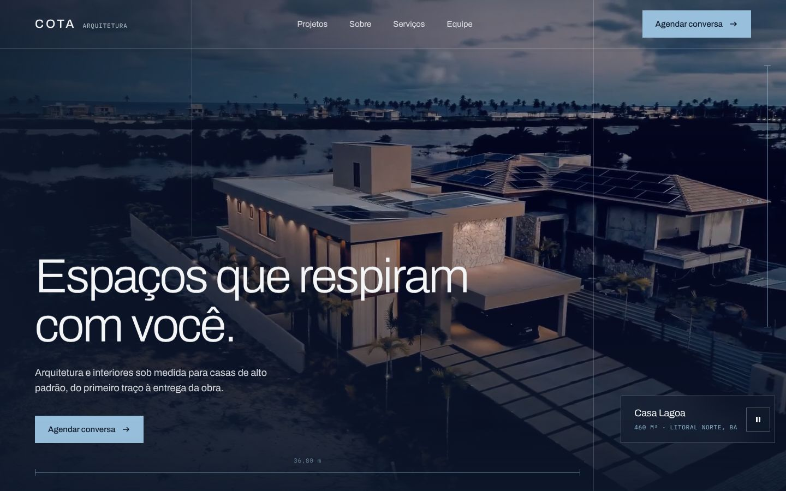
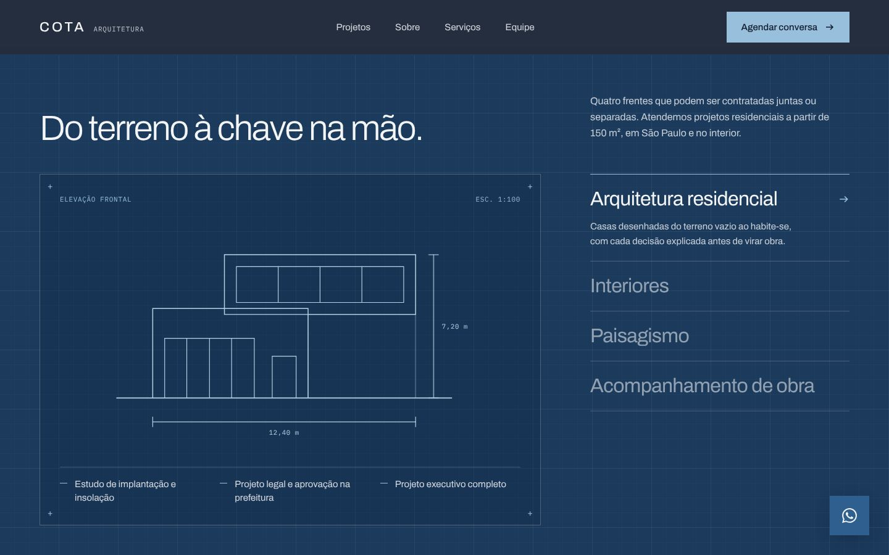
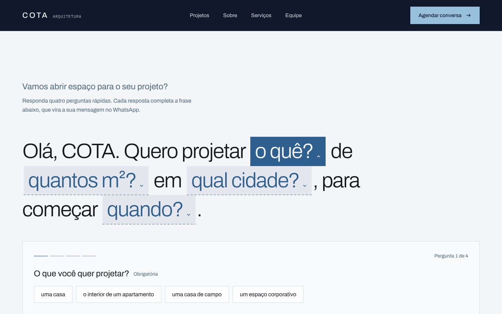
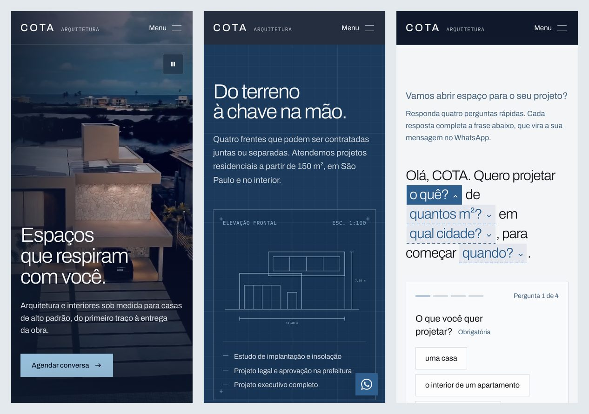

# COTA Arquitetura

Landing page de um escritório de arquitetura de alto padrão, do conceito ao código. É um **case fictício de portfólio**: a marca, a equipe, os números e os contatos foram criados para o projeto.

Fiz o processo inteiro, como faria num projeto real: briefing, identidade visual, arquitetura de informação, layout no Figma e desenvolvimento front-end.

<!-- Depois do deploy, troque pela URL da Vercel: **[Ver o site →](https://seu-link.vercel.app)** -->



| Serviços como prancha técnica | Pré-briefing que vira mensagem no WhatsApp |
|---|---|
|  |  |



## O desafio

Para quem procura um arquiteto de alto padrão, o site é o primeiro contato com o escritório. O objetivo era:

- passar confiança e cuidado logo no primeiro scroll;
- levar o visitante até o WhatsApp **com o projeto já descrito**, para o escritório receber um contato qualificado, e não um "oi, quanto custa?";
- ter movimento que valorize o trabalho sem pesar no carregamento.

## Decisões que valem destacar

**Conversão**
- Uma única ação no site inteiro, sempre com o mesmo texto: "Agendar conversa".
- O formulário é uma frase com lacunas: "Quero projetar ___ de ___ m² em ___". São quatro perguntas, uma por vez, e só a primeira é obrigatória. A frase pronta vira a mensagem do WhatsApp, que a pessoa revisa antes de enviar.
- O botão flutuante do WhatsApp some no hero e no formulário, onde já existe um CTA na tela.

**Identidade**
- O nome COTA vem da medida no desenho técnico. Essa ideia guia o visual inteiro: linhas de prancha, cotas, coordenadas no cursor e desenhos que se traçam na tela.
- Paleta de azuis noturnos e névoa, definida em tokens no `@theme` do Tailwind.
- Tipografia: Archivo variável para títulos e textos, IBM Plex Mono para medidas e legendas.

**Movimento (só CSS, sem biblioteca)**
- Hero fixo, com a página deslizando por cima. A abertura roda só na primeira visita da sessão.
- Manifesto que acende palavra por palavra conforme o scroll, com `animation-timeline: view()`.
- Desenhos técnicos em SVG que se traçam linha a linha. O comprimento de cada traço é medido com `getTotalLength()`, para a animação não falhar.
- Curvas de easing próprias, feedback de toque em todos os botões e hover só em dispositivos com mouse.
- Com "reduzir movimento" ativado no sistema, as animações são desligadas e o conteúdo aparece direto.

**Performance**
- O HTML é pré-renderizado no build com `react-dom/server`, e o React só hidrata a página. O conteúdo aparece antes do JavaScript carregar.
- Script próprio com `sharp` (`npm run images`) que gera AVIF e WebP em várias larguras, guarda as dimensões para evitar layout shift e avisa quando uma foto original tem resolução baixa.
- Vídeo do hero:
  - versão de 720p em retrato para celular;
  - só começa a carregar depois que a página termina de carregar;
  - não carrega com economia de dados, em conexões lentas ou com "reduzir movimento";
  - pausa quando sai da tela ou quando a aba fica em segundo plano.
- Preload da foto do hero e da fonte principal, injetados por um plugin do Vite.

**Acessibilidade**
- HTML semântico, link para pular ao conteúdo e títulos em ordem.
- Os serviços são um componente de abas acessível (WAI-ARIA), que funciona com setas, Home e End.
- O formulário guia o foco entre as perguntas e anuncia os erros para leitores de tela.
- Contraste AA, áreas de toque de pelo menos 44 px e botão para pausar o vídeo.

## Resultados (Lighthouse)

| | Performance | Acessibilidade | Boas práticas | SEO |
|---|---|---|---|---|
| Desktop | 100 | 100 | 100 | 100 |
| Mobile | 92 | 100 | 100 | 100 |

O resultado mobile foi medido com a simulação padrão do Lighthouse (4G lento e CPU 4x mais lenta).

## Stack

React 19 · TypeScript (strict) · Vite 6 · Tailwind CSS 4 · ESLint · sharp · Figma

Não usei bibliotecas de UI nem de animação. Os únicos pacotes de runtime são o React, as fontes self-hosted e o ícone do WhatsApp (`simple-icons`).

## Estrutura

```
src/
  components/      Seções da página (Hero, About, Projects, Services, Team, Contact) e peças de UI
  data/content.ts  Todo o conteúdo do site, tipado (textos, projetos, serviços, equipe)
  lib/             Hooks (useInView, useMediaQuery) e montagem da mensagem do WhatsApp
  entry-server.tsx Renderização usada na pré-renderização do build
  index.css        Tokens de design, animações e estilos que o Tailwind não cobre
scripts/
  optimize-images.mjs  Pipeline de imagens (AVIF/WebP)
  prerender.mjs        Injeta o HTML pré-renderizado em dist/index.html
assets/images/     Fotos originais
public/            Imagens otimizadas, vídeos, favicon e imagem de compartilhamento
```

## Como rodar

```bash
npm install
npm run dev
```

| Comando | O que faz |
|---|---|
| `npm run dev` | Servidor de desenvolvimento |
| `npm run build` | Checa os tipos, gera o build e pré-renderiza o HTML em `dist/` |
| `npm run preview` | Abre o build localmente |
| `npm run lint` | ESLint |
| `npm run images` | Converte as fotos de `assets/images/` para AVIF e WebP em `public/images/` |

## Deploy

O projeto está pronto para a Vercel e não precisa de configuração extra. A URL de produção entra sozinha no canonical e nas tags de compartilhamento. Para usar outro domínio, defina a variável `VITE_SITE_URL`.

## Créditos

- Projeto fictício. O número de WhatsApp (`WHATSAPP_NUMBER` em `src/data/content.ts`), o endereço e as pessoas da equipe não existem.
- Fotos e vídeo de bancos de imagens gratuitos, usados apenas para ilustrar o case. Os direitos pertencem aos autores originais.

---

Design e desenvolvimento por **Sabrina Vieira Lobo** · [GitHub](https://github.com/Sabrina-vlobo)
